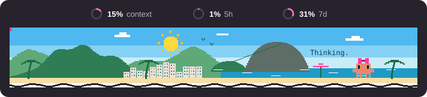

# rio-band



*Цифры на картинке для примера, у вас будут ваши.*

Мод для Claude Code: пиксельная панорама Рио-де-Жанейро над полем ввода. Солнце, Сахарная голова с канатной дорогой, пляж Копакабаны и маскот Claude с розовым бантиком.

Над панорамой три показателя: заполнение контекста (context), расход лимита за 5 часов (5h) и за неделю (7d).

## Установка

В сессии Claude Code в терминале введите:

```
/plugin install rio-band --marketplace rimmacfo2026-cmyk/rio-band
```

Подтвердите добавление источника (`y`) и выберите, где установить мод. Плашка появится в новой сессии.

Или из командной строки:

```bash
claude plugin install rio-band --marketplace rimmacfo2026-cmyk/rio-band
```

## Что важно знать

- Мод неофициальный и не связан с Anthropic. Claude и Claude Code являются товарными знаками Anthropic, маскот Clawd принадлежит Anthropic. Лицензия MIT на них не распространяется.
- Нужен Claude Code версии 2.1.287 или новее. Проверить версию: `claude --version`.
- В обычном терминале панорамы нет: там не поддерживается нужный элемент. Мод там ничего не рисует и не мешает работе.
- Надпись Thinking и покачивание маскота видны только во время работы Claude.
- Цифры дает сам Claude Code. Если показателя 5h или 7d нет (например, без подписки), он просто не показывается.
- Интерфейс модов Claude Code пока в раннем доступе и может меняться, поэтому в новых версиях мод может перестать работать. Собрано на версии 2.1.309.
- Ширина панорамы задана жестко (680 пикселей), в узком окне она может не поместиться.

## Удаление

```bash
claude plugin uninstall rio-band@rimma-rio
```

## Лицензия

MIT, текст в файле [LICENSE](LICENSE).
